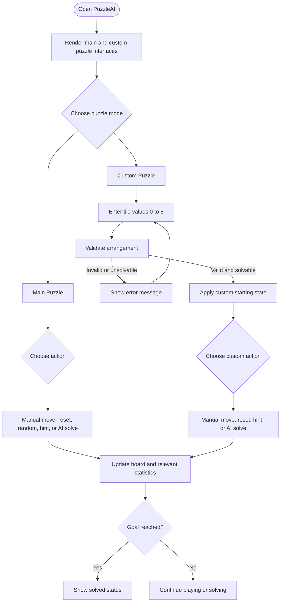
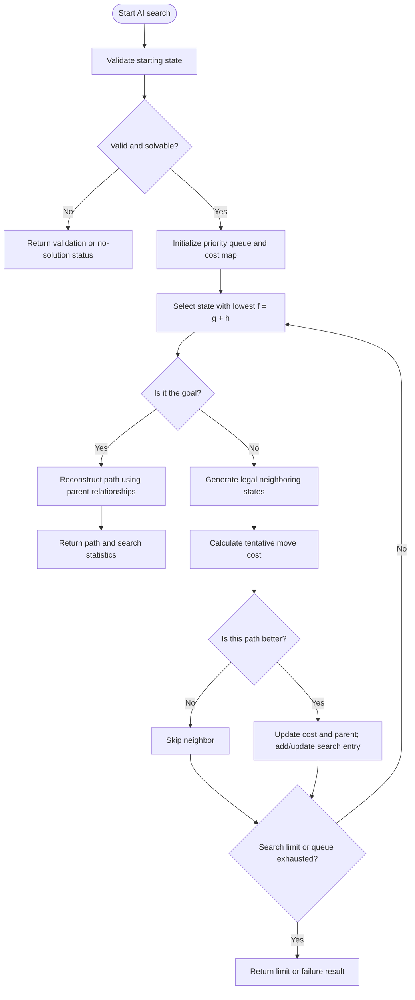
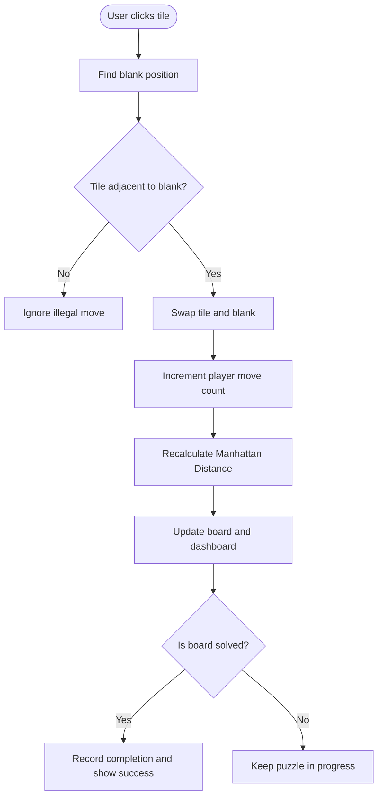
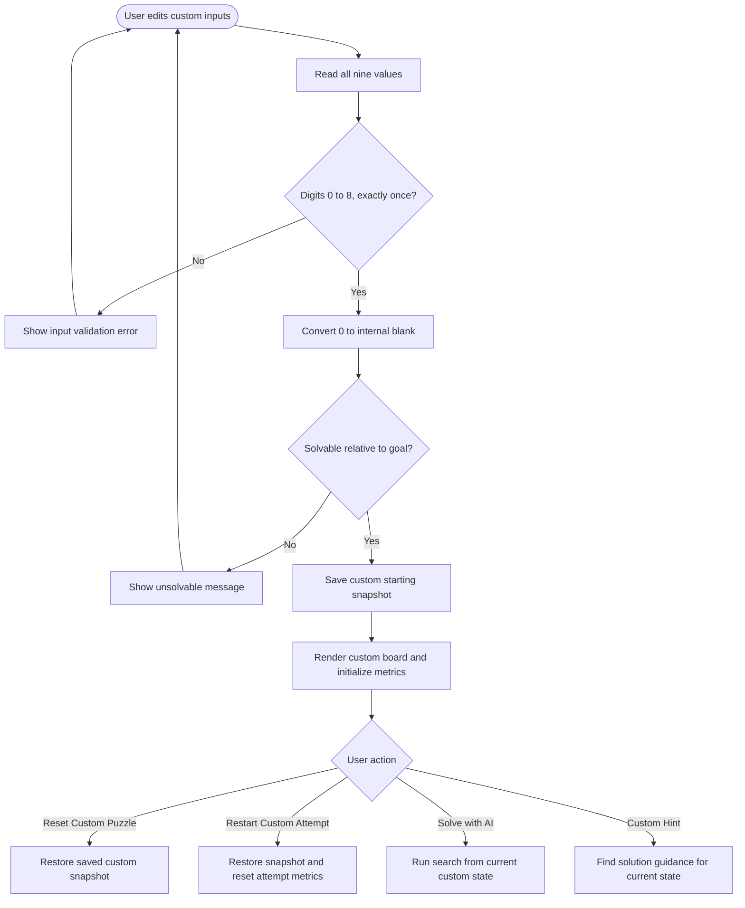
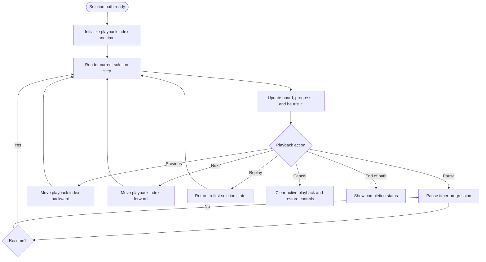
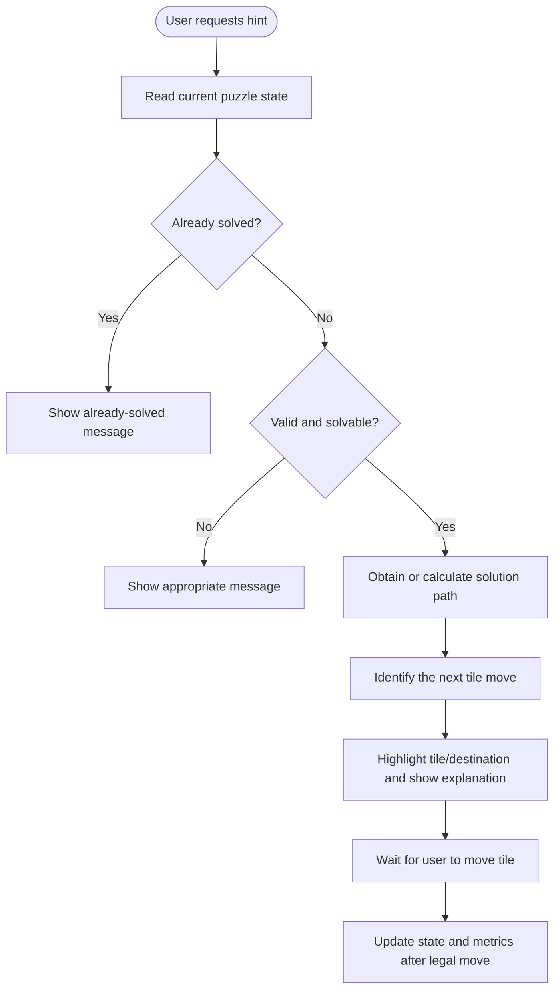

# PuzzleAI — 8-Puzzle AI Solver

A browser-based 8-Puzzle game and AI search demonstration built with **HTML, CSS, and vanilla JavaScript**. Users can solve a puzzle manually, enter their own arrangement, ask the AI to find a solution, watch solution playback, inspect search statistics, and compare search strategies.

> **Project type:** Frontend web application  
> **Runtime:** Modern web browser  
> **Development setup:** Visual Studio Code + Live Server  
> **Theme:** Dark, futuristic interface

---

## Table of contents

- [Project overview](#project-overview)
- [Goals](#goals)
- [Technology stack](#technology-stack)
- [Features](#features)
- [Project structure](#project-structure)
- [Getting started](#getting-started)
- [How to play](#how-to-play)
- [AI and algorithm concepts](#ai-and-algorithm-concepts)
- [Flowcharts](#flowcharts)
- [Statistics explained](#statistics-explained)
- [Custom puzzle validation](#custom-puzzle-validation)
- [Testing checklist](#testing-checklist)
- [Troubleshooting](#troubleshooting)
- [Limitations and future improvements](#limitations-and-future-improvements)
- [Capstone summary](#capstone-summary)

---

## Project overview

The **8-puzzle** is a classic state-space search problem. It consists of a 3×3 board with eight numbered tiles and one blank cell. A legal move slides a tile adjacent to the blank into the empty cell. The objective is to reach the goal arrangement:

```text
1 2 3
4 5 6
7 8 _
```

PuzzleAI supports two puzzle modes:

1. **Main Puzzle** — play the default puzzle manually or ask the AI to solve it.
2. **Custom Puzzle Solver** — enter a specific arrangement, validate it, apply it to the board, then solve or request a hint for that arrangement.

The application uses A* search as its primary solver and Manhattan Distance as its heuristic. It also provides a comparison of A*, Greedy Best-First Search, and Breadth-First Search, with a per-algorithm expanded-node limit for comparison runs.

## Goals

- Demonstrate an informed AI search algorithm in an interactive web interface.
- Show how a heuristic can guide search toward a goal state.
- Let users experiment with their own puzzle configurations.
- Distinguish player activity from AI search and playback activity.
- Present useful search statistics and a visual solution path.
- Explain the puzzle and algorithm in a student-friendly format.

## Technology stack

| Technology | Role |
|---|---|
| HTML5 | Page structure, puzzle boards, controls, and dashboard |
| CSS3 | Dark theme, layout, visual styling, responsive rules, and animations |
| Vanilla JavaScript | Puzzle state, validation, legal moves, search, hints, playback, and statistics |
| A* Search | Main AI search strategy |
| Manhattan Distance | Heuristic function for A* |
| Browser DOM APIs | Rendering board states and updating the interface |
| `localStorage` | Persisting supported history, records, and settings |
| VS Code + Live Server | Local development and browser preview |

No frontend framework or server-side application is required for the current version.

## Features

### Main puzzle

- Interactive 3×3 board.
- Legal tile movement into the adjacent blank.
- Player move counter and elapsed time.
- Current and initial Manhattan Distance.
- Distance improvement display.
- Reset to the configured main starting state.
- Random solvable puzzle generation by making legal moves from the goal.
- Manual completion detection.

### Custom puzzle

- Nine input values representing tiles `0`–`8`.
- `0` represents the blank cell.
- Validation for invalid or duplicate values.
- Solvability check before a puzzle is accepted.
- Apply, reset, and restart controls.
- Separate custom puzzle board and status.
- AI solving and hint actions for the applied custom state.

### AI solving and playback

- A* solution search.
- Solution path reconstructed from stored parent/state relationships.
- Animated playback of the calculated solution.
- Pause, resume, previous move, next move, replay, and cancel controls.
- Playback progress, search time, and playback elapsed time.
- Protection against conflicting search/playback actions.
- Handles solved states and unsuccessful/limited searches with status feedback.

### Hints

- Hint action for the main puzzle and custom puzzle.
- Uses a solution for the current state to identify a next move.
- Displays guidance without automatically moving the tile.
- The user can make the suggested move manually.

### Search analytics

The interface can display:

- Player moves and elapsed time.
- Current and initial Manhattan Distance.
- Distance improvement.
- Optimal solution length when a solution is available.
- AI playback progress.
- AI search time and playback elapsed time.
- Expanded nodes and discovered states.
- Peak open-list size.
- Current `g(n)`, `h(n)`, and `f(n)` values.
- Solver status.

A dash (`—`) indicates that a metric is not currently available or does not apply to the current operation.

### Algorithm comparison

The comparison panel runs the current main-puzzle state through:

- **A\*** (`astar`)
- **Greedy Best-First Search** (`greedy`)
- **Breadth-First Search** (`bfs`)

It reports solution length, expanded nodes, search time, and a note about optimality or search limits. Each comparison run uses an expanded-node cap of 25,000 to reduce the risk of excessive work in the browser. Runtime varies by device and puzzle state. BFS can consume substantially more memory than A*.

### Interface and accessibility

- Dark futuristic visual theme.
- Responsive layout rules for narrower screens.
- Status messages and accessible labels for interactive elements.
- Compact playback icon buttons with labels/tooltips.
- Keyboard-friendly focus states where styled by the interface.

### Persistent browser data

The application defines `localStorage` keys for supported history, records, and settings. These values are stored in the current browser profile, not in a remote account. Clearing browser site data can remove them.

---

## Project structure

```text
puzzle_8/
├── index.html   # Sections, puzzle boards, controls, statistics, and content
├── style.css    # Dark theme, cards, grids, responsive layout, and button styles
├── script.js    # Puzzle state, validation, A*, hints, playback, metrics, and storage
└── README.md    # Project documentation
```

### File responsibilities

- **`index.html`**: Defines the Home, About, Solver, and How It Works sections, including the main and custom puzzle interfaces.
- **`style.css`**: Controls the visual appearance, board tiles, dashboards, controls, spacing, and responsive behavior.
- **`script.js`**: Contains the puzzle state and rules, solvability logic, heuristic, search algorithms, playback lifecycle, hint handling, and UI updates.

---

## Getting started

### Requirements

- A recent version of Chrome, Edge, Firefox, or another modern browser.
- Visual Studio Code.
- The Live Server extension for VS Code (recommended).

### Run locally

1. Download and extract the project ZIP.
2. Open the extracted `puzzle_8` folder in VS Code.
3. Locate `index.html`.
4. Right-click `index.html` and choose **Open with Live Server**.
5. The application opens in the browser.
6. If CSS changes do not appear, hard-refresh the page with `Ctrl + Shift + R`.

You can also open `index.html` directly in a browser for basic use, but Live Server is recommended while developing.

---

## How to play

### Main Puzzle

1. Open the Solver section.
2. Click a tile next to the blank cell to move it.
3. Watch the player move counter and Manhattan Distance update.
4. Use **Reset Puzzle** to return to the configured starting arrangement.
5. Use **Random Puzzle** to generate a new solvable arrangement.
6. Use **Solve with AI** to calculate and play a solution.
7. Use the playback controls to pause, resume, step through, replay, or cancel playback.
8. Use **Hint** to see a recommended next move.

### Custom Puzzle Solver

1. Enter all nine values from `0` to `8`, each exactly once.
2. Use `0` for the blank.
3. Select **Apply Custom Puzzle**.
4. If the arrangement is valid and solvable, it is applied to the custom board.
5. Select **Solve Custom Puzzle with AI** to search for a solution.
6. Select **Custom Hint** for guidance on the next move.
7. Use **Reset Custom Puzzle** to restore the saved custom starting arrangement.
8. Use **Restart Custom Attempt** to restart the current attempt and its attempt statistics.

If the input is invalid or unsolvable, read the status message and correct the input before applying it.

---

## AI and algorithm concepts

### State representation

The board is represented internally as an array of nine string values. The blank is represented by an empty string (`""`). The custom input uses `0` to represent that blank, then converts it to the internal blank representation when applied.

Example:

```text
Visual board:       Internal state:
1 2 3               ["1","2","3",
4 5 6                "4","5","6",
7 _ 8                "7","","8"]
```

A state key is formed from the array values so search can identify previously encountered states.

### Legal moves and neighbor states

The blank can move up, down, left, or right, provided the destination remains inside the 3×3 board. For each legal move, the algorithm creates a new state by swapping the blank with an adjacent tile.

### Manhattan Distance

For each numbered tile, Manhattan Distance is the number of horizontal and vertical grid steps between its current position and its goal position. The blank is excluded.

\[
h(n)=\sum_{t=1}^{8}\left(|r_t-r_t^*|+|c_t-c_t^*|\right)
\]

- `r`, `c`: the tile's current row and column.
- `r*`, `c*`: the tile's goal row and column.
- `h(n)`: the heuristic estimate of the remaining work.

A smaller heuristic usually means the tiles are closer to their goal positions, but the heuristic alone is not a proof that a state is the best next choice.

### A* Search

A* prioritizes states using:

\[
f(n)=g(n)+h(n)
\]

- `g(n)`: actual number of moves from the starting state to state `n`.
- `h(n)`: Manhattan Distance estimate from `n` to the goal.
- `f(n)`: estimated total solution cost through `n`.

With unit-cost moves and the admissible Manhattan Distance heuristic, A* can find an optimal solution when the search implementation correctly manages costs and repeated states.

The implementation uses a min-heap priority queue to efficiently retrieve the state with the lowest priority score. It tracks known costs and parent/state relationships to avoid accepting a path that is no better than a known path to the same state. The final path is reconstructed after reaching the goal.

### Solvability

For the 3×3 8-puzzle, solvability can be checked by counting inversions in the sequence of numbered tiles, ignoring the blank. An inversion occurs when a larger numbered tile appears before a smaller numbered tile. For the standard goal arrangement on an odd-width board, an even inversion count indicates a solvable state.

The application checks custom arrangements before attempting to solve them.

### Search strategies compared

| Strategy | Priority idea | Optimality |
|---|---|---|
| A* | `g(n) + h(n)` | Optimal with an admissible heuristic and correct implementation |
| Greedy Best-First | `h(n)` | Not generally optimal |
| Breadth-First Search | Shallowest depth first | Optimal when every move has equal cost, but can use significant memory |

The comparison feature is an educational experiment. Runtime depends on hardware, browser load, and puzzle difficulty. A result limited by the configured node cap is not a proof that no solution exists.

---

## Flowcharts

The following diagrams use Mermaid. They render on platforms that support Mermaid, including many Git hosting and Markdown preview tools. If your preview does not render them, read the text flow in each diagram or use a Mermaid-compatible Markdown viewer.

### 1. Overall application flow



### 2. A* search flow



### 3. Manual move flow



### 4. Custom puzzle apply and reset flow



### 5. AI playback lifecycle



### 6. Hint flow



---

## Statistics explained

| Metric | Meaning |
|---|---|
| Player moves | Number of legal moves performed manually during the current attempt |
| Player elapsed | Time spent on the player's attempt |
| Current Manhattan | Sum of each numbered tile's Manhattan distance from its goal position |
| Initial Manhattan | Manhattan Distance at the start of the current attempt |
| Distance improvement | Initial heuristic minus current heuristic |
| Optimal solution | Number of moves in the calculated optimal path, when available |
| AI playback | Current playback step compared with the total path length |
| AI search time | Time spent calculating the solution |
| Playback elapsed | Time spent in solution playback |
| Expanded nodes | Search states expanded by the algorithm |
| Discovered states | States discovered by the search |
| Peak open list | Maximum number of entries in the frontier/open list |
| `g(n)` | Cost from the start state to the current search state |
| `h(n)` | Heuristic estimate from the current state to the goal |
| `f(n)` | `g(n) + h(n)` |
| Solver status | Current state of the puzzle/solver, such as ready, solving, or solved |

Metric meanings depend on the current action. Player statistics and AI playback/search statistics should not be treated as interchangeable.

---

## Custom puzzle validation

A valid custom puzzle must contain each of the nine values exactly once:

```text
0 1 2
3 4 5
6 7 8
```

The order may differ; the example only illustrates the allowed values. `0` represents the blank. An input is invalid if it contains duplicates, missing values, values outside the allowed range, or an incorrect number of cells. A valid arrangement can still be unsolvable, so validation and solvability are separate checks.

The standard goal is:

```text
1 2 3
4 5 6
7 8 0
```

---

## Testing checklist

Use this checklist after making code changes or before presenting the project.

### Main puzzle

- [ ] The page loads without JavaScript errors.
- [ ] A legal adjacent tile moves into the blank.
- [ ] An illegal move does not change the board or player move count.
- [ ] Manhattan Distance updates after each legal move.
- [ ] Reset restores the configured main starting state.
- [ ] Random Puzzle produces a reachable arrangement.
- [ ] Manual completion displays a success state.

### AI solver and playback

- [ ] Solve with AI reaches the goal state.
- [ ] The solution length matches the number of transitions in the returned path.
- [ ] Already-solved states are handled.
- [ ] Pause and Resume work.
- [ ] Previous and Next move through the stored path.
- [ ] Replay starts from the beginning of the stored solution.
- [ ] Cancel stops playback and restores controls.
- [ ] Search time and node statistics are updated from actual search results.

### Custom puzzle

- [ ] A valid custom arrangement applies correctly.
- [ ] The blank value `0` renders as an empty cell.
- [ ] Duplicate or missing values are rejected.
- [ ] An unsolvable arrangement is rejected.
- [ ] Custom AI solving starts from the applied custom arrangement.
- [ ] Reset Custom Puzzle restores the saved custom arrangement.
- [ ] Restart Custom Attempt restores the start and resets attempt metrics.
- [ ] Custom Hint gives guidance without moving a tile automatically.

### UI and browser

- [ ] Dark theme remains enabled.
- [ ] Main and custom dashboards fit the intended column layout.
- [ ] Custom input and solver panels align side-by-side on desktop.
- [ ] Layout stacks sensibly on narrow screens.
- [ ] Playback controls have understandable labels/tooltips.
- [ ] No buttons overlap or disappear.
- [ ] No avoidable errors appear in the browser console.

---

## Troubleshooting

### The page does not reflect CSS changes

Hard-refresh the browser using `Ctrl + Shift + R`. Confirm that `index.html` references the expected `style.css` file and that both files are in the same project folder.

### A button does not respond

Open Developer Tools (`F12`), select **Console**, and inspect any red error messages. Confirm the button's `data-action` value matches the action handled in `script.js`.

### A custom puzzle is rejected

Check that all digits `0`–`8` appear exactly once and that `0` is used for the blank. Then check whether the arrangement is solvable.

### Algorithm comparison takes a long time

BFS may use substantial memory. The comparison feature has an expanded-node cap; a capped result is a resource limit, not proof that no solution exists.

### Stored history or settings look stale

The browser can retain `localStorage` values between visits. Use the application's available controls to clear supported data, or clear the site's local storage through browser developer tools if necessary.

---

## Limitations and future improvements

Potential extensions include:

- Search-tree visualization.
- Additional heuristic strategies such as Linear Conflict.
- More algorithm comparisons and benchmark reports.
- Accessibility improvements and keyboard-first gameplay.
- More automated unit and integration tests.
- Exportable solve reports.
- Additional puzzle difficulty presets and educational examples.

These are future enhancements unless explicitly present and tested in the current codebase. Algorithm timing can vary by device and browser, so benchmark values should not be treated as universal.

## License

No license has been specified for this project. Add a license file if you intend to publish or distribute the code under particular reuse terms.
